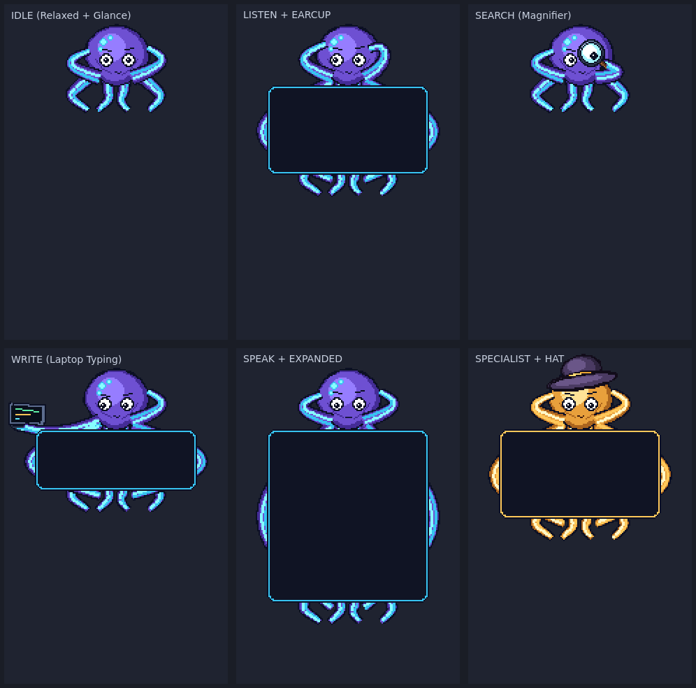
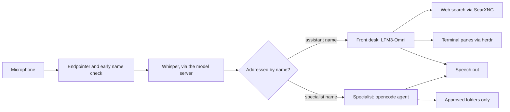

# VoiceAssistant

A screen-aware voice assistant for the Linux desktop. A pixel-art octopus lives on the screen: press the shortcut,
say the assistant's name, ask a question, and it answers out loud and on the octopus's card. It can look at the
screen, search the web, work with your terminal panes, and hand longer work to a specialist agent that can read and
write in folders you approve.



| State | When |
|---|---|
| Idle | Nothing is happening. The octopus floats and glances around. |
| Listen | The card is open and the microphone is recording. |
| Search | The assistant is searching the web: a magnifying glass in front of an eye. |
| Write | The octopus types on a laptop while an answer is being written. |
| Speak | The answer is being read aloud. The card expands with the text. |
| Specialist | The specialist agent is active: amber colours and a detective fedora. |

## How it works



- **Name gate.** A turn is only answered when it starts with a name: the assistant's name goes to the front desk, the
  specialist's name goes to the specialist. Names are learned during a short spoken setup, which records several
  takes and keeps the forms Whisper agrees on.
- **Early name check.** While you are still speaking, the opening is checked for the name, so the octopus raises its
  arm before you finish. The check never ends a turn.
- **Terminal panes (herdr).** Ask what a pane shows, or what is open, and the front desk reads the real pane output
  and answers from it. Asking to send a prompt to a pane stages it: the card reads it back and sends it only after
  you say yes. Nothing is typed into a pane without that yes.
- **Specialist sandbox.** The specialist can read approved folders and write only in its own folder. Approved folders
  are read-only. It has no shell. Diagrams come back as HTML files opened in the browser.
- **Desktop integration.** A tray icon (left click hides or shows the octopus; right click has settings, restart and
  close) and an application-menu entry.

## Requirements

- Linux with PipeWire or PulseAudio (`paplay`, `parec`, `pactl`), `ffmpeg`, `xdg-open`, and `gtk-launch`.
- Python 3.11 or newer.
- An OpenAI-compatible model server that serves a speech-to-text model (Whisper) and a chat model (LFM3-Omni).
  The URLs are configurable (see below).
- Optional: herdr, the terminal-pane command line (`herdr pane list`), for the terminal-pane features.
- Optional: a CPU router for choosing between the front desk and the specialist. It uses System One:
  <https://github.com/y0c0ms/System1QLoRa>. Without it, a keyword and classifier fallback is used.
- Optional: [SearXNG](https://github.com/searxng/searxng) for web search.

## Install

```bash
git clone https://github.com/y0c0ms/VoiceAssistant.git
cd VoiceAssistant
python3 -m venv .venv
.venv/bin/pip install -e .          # the package and its dependencies; adds the `voiceassistant` command

# Portuguese speech runs in its own environment
python3 -m venv .venv-phoonnx
.venv-phoonnx/bin/pip install -r requirements-tts.txt
```

Speech models are not included. Put the Portuguese voice files in `voices/` at the repository root (see
`src/voiceassistant/speech/tts_tugaphone.py` for the expected names).

## Configuration

On first run the example config (`src/voiceassistant/config.example.yaml`) is copied to
`~/.config/voiceassistant/config.yaml`. It holds the names, the service URLs, the voices, and the folders the
specialist may use. Environment variables override the URLs:

| Variable | Default | Purpose |
|---|---|---|
| `VA_CHAT` | `http://127.0.0.1:11435/v1/chat/completions` | Chat model for screen questions |
| `VA_WHISPER` | `http://127.0.0.1:11435/v1/audio/transcriptions` | Speech-to-text |
| `VA_SWAP` | `http://127.0.0.1:11435` | Model server root |
| `VA_MODEL` | `lfm3-omni` | Chat model name |
| `VA_MIC` | echo-cancelled source, then the default | Microphone source |
| `SEARXNG_URL` | `http://127.0.0.1:30850` | Web search |

## Run

```bash
voiceassistant                  # starts the overlay with the tray icon
voiceassistant --toggle         # start a card, or stop a running one (use this for a shortcut)
voiceassistant --show           # show the octopus again (the application-menu entry runs this)
voiceassistant --setup          # record the assistant's name again
voiceassistant --setup-specialist
```

The first run records the assistant's name. Say the sentences shown on the card, one at a time.
`python -m voiceassistant` works the same way.

## Tests

```bash
python tests/logic/test_logic.py
```

The logic suite (169 checks) covers routing, name matching, herdr request parsing, permissions, speech text and the
animation timing. It needs no model server and no audio device.

## Layout

The code is the `voiceassistant` package under `src/`:

| Path | What it is |
|---|---|
| `src/voiceassistant/app.py` | The session loop, shortcut handling, tray, restart |
| `src/voiceassistant/paths.py` | Where the package finds the repository's voices and the speech virtualenv |
| `src/voiceassistant/core/` | Configuration, the model-server client, audio devices, the stop-phrase check |
| `src/voiceassistant/speech/` | Speech out, sentence by sentence; the Portuguese voice script |
| `src/voiceassistant/answers/` | The realtime front desk, web search, screen questions |
| `src/voiceassistant/agents/` | The specialist, folder and app opening, herdr terminal panes |
| `src/voiceassistant/ui/` | The octopus renderer and widget, the window, the tray icon, the taskbar exclusion, answer formatting |
| `docs/animations/` | Renders of the animation states |
| `tests/logic/` | The logic suite |

## Status

Working on Linux (Plasma under XWayland). Recognition of the assistant's name depends on the speech model and the
microphone: short openings are often transcribed poorly, so the early check only raises the arm and never ends a
turn. Terminal-pane requests are recognised from their wording; a question about panes that uses other words goes to
the normal answer. The specialist's write confirmation is replaced by the folder rule (approved folders are
read-only).

No license has been chosen yet.
